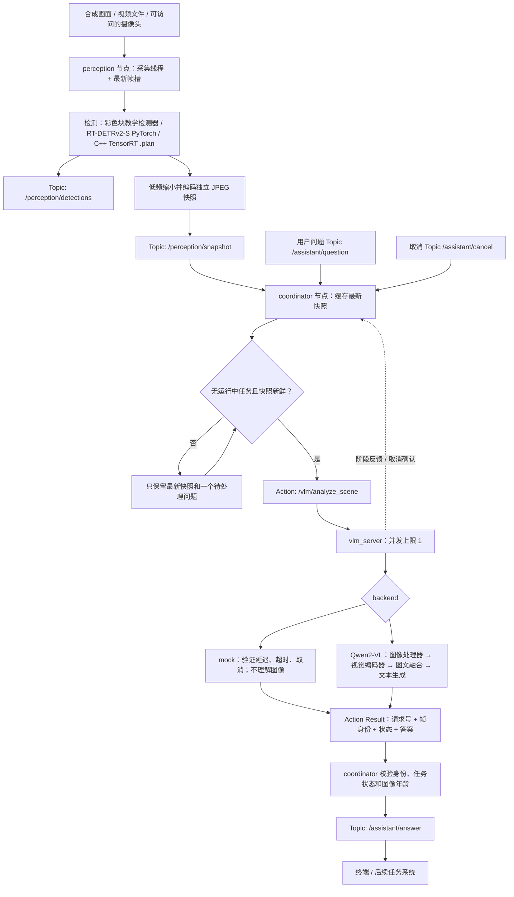
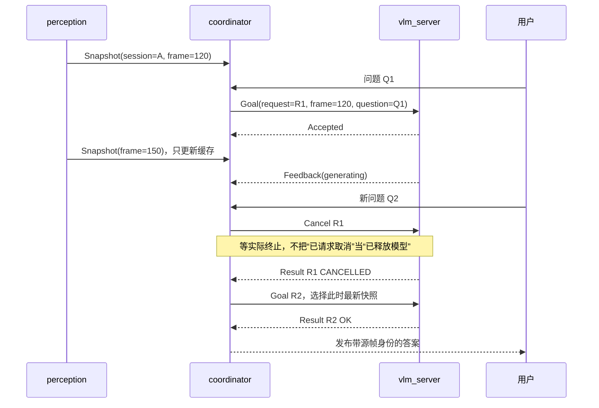

# PC 上的 ROS2 + VLM 感知问答：代码与实施教程

> 历史参考教程。新版以 [6个大任务计划](每日开发路线.md) 为主线，业务节点目标为C++；本教程中的Python实现用于理解接口与迁移前行为。


> 本文保留早期 Python 感知节点版本的原理说明，部分命令和目录对应早期独立工程。本项目的权威运行入口是 `days/dayNN/run.py`；ROS 源码已放到 `ros_ws/src/`，完整 C++ 主链路使用 `course.launch.py` 和 `cpp_bridge`。环境安装、验证状态与阶段验收以本目录的 `README.md`、`环境搭建.md`、`验证说明.md` 为准。旧版关于“没有手写 CUDA/DMABUF”的说明仅适用于早期 Python 节点，不适用于新建的 `pc/` 与 `jetson/` 源码。

适用环境：Win11 + WSL2 Ubuntu 22.04；ROS2 Humble；尚未学习 ROS2、尚无 Jetson 的开发者。

## 1. 这次交付能做什么

你会得到一个具体的程序：画面持续更新、检测持续运行；你提出“画面里是什么、在哪里”等问题，程序取一张最新的独立图像，交给 VLM，最后返回携带原始帧身份的答案。VLM 慢时不会使待处理图像无限积压；你可以取消问题，或者用新问题替换旧问题。

代码包含两套 ROS2 package、三个节点、四种消息、一个 Action，以及可以直接运行的无 ROS 模拟程序和 13 项核心规则测试。默认无需相机和模型；真实模式支持图片输入的 Qwen2-VL，检测支路使用 RT-DETRv2-S；Python PyTorch 用于功能基线，C++ TensorRT 用于部署优化。

**当前验证边界：** 核心 Python 测试与不依赖 ROS 的并发模拟已经运行；当前可访问的执行环境没有可用的 ROS2、PyTorch/CUDA 和模型权重，所以 ROS2 编译/通信、真实 GPU 推理、TensorRT engine 路径尚未运行验证。下面的 ROS 节点和模型适配器是实际实现代码，不是接口占位，但需要你在 WSL 中进行集成验收。

**这是项目的 PC 功能闭环版本。** 采集使用 OpenCV 拥有的 CPU 图像，快照用 JPEG 复制到消息；检测库管理 GPU 传输与推理。它没有实现手写 CUDA kernel、预分配的 CUDA tensor 池、DMABUF、Jetson VIC 或全链路零拷贝，也没有控制实体机器人。优化版的替换位置在第 13 节。

## 2. 先认识四个 ROS2 概念

| 概念 | 在本项目里是什么 | 具体例子 |
|---|---|---|
| Node（节点） | 专门负责一类工作的程序；本项目每个节点一个进程 | perception、coordinator、vlm_server |
| Topic（话题） | 持续发布消息，发布方不等待某个订阅方完成 | 检测结果、图像快照、用户问题、最终答案 |
| Action（动作接口） | 一项可能耗时数秒的任务，含请求、反馈、结果、取消 | “请根据这张图回答这个问题” |
| Launch | 一次启动多个节点并传入参数 | 一个命令启动整个演示 |

ROS2 不负责看懂图像，它负责把不同程序连接起来。VLM 才负责把图像和文字问题一起处理。Action 的“动作”只是 ROS 接口名称，不代表必须驱动电机。此版本没有定义机械运动命令。

为什么不用普通 Topic 直接塞 VLM 请求：你还需要知道请求是否被接受、是否在运行、是否取消、最终属于哪一次问题。Action 已提供这类生命周期语义，我们再补充图像身份和超时策略。

## 3. 实现流程图



高速检测与慢速问答是两条支路。VLM 获得的是独立图像，不需要等检测框变成另一种模型的 feature。`Snapshot` 里的检测框用于关联和调试，当前 Qwen2-VL 实现只使用图像和问题，避免误导你认为 RT-DETR 特征可以直接喂给任意 VLM。

节点分进程可以隔离 Python 回调阻塞和模型异常，但不能自动隔离 GPU 算力或显存。真实 VLM 与检测同时运行时仍需测量竞争，必要时降低问答频率、视觉 token 数或关闭旁路。

## 4. 一次问答到底怎样执行

以“画面里红色物体在哪里？”为例：

1. 采集线程持续产生图像，放入一个最新帧槽。新帧覆盖的是未消费帧，已经被检测线程取走的图像是独立拥有的对象。
2. 检测结束后发布原图坐标系的框；每秒最多发布一张缩小 JPEG。快照与框取自同一个源帧，附相同会话 UUID、帧号、采集时间。
3. coordinator 收到问题，检查 Action server 是否可用、是否已有任务、缓存图像是否新鲜。
4. 选定快照后生成 request UUID；此任务始终绑定该快照。后面新到的画面只更新“下一次任务可用的图像”，不能替换已经发送的内容。
5. server 验证输入上限和时间，预留唯一执行槽。如果已有其他任务，直接拒绝，不在模型服务内部积压请求。
6. 真实后端解码 JPEG 为 RGB，使用 Qwen2-VL 自己的 processor、视觉编码器、tokenizer 和聊天模板，执行图文条件生成。模型初始化只做一次。
7. 生成期间发布阶段与耗时反馈，并检查取消/截止时间。默认最多生成 64 个新 token。
8. 完成后，server 返回源帧身份、结果状态、模型名称、耗时及答案。coordinator 再核对 request ID、session ID、frame number 和时间戳，确保不是别的请求或另一轮采集的结果。
9. 如果图像已过期、问题已被替换或任务超时，发布对应状态并清空文本。成功时把答案发布到 `/assistant/answer`。



取消是协作式的：mock 每 10 ms 左右检查；真实 transformers 后端在生成步骤间检查。正在执行的 GPU kernel、图像预处理或首轮 prefill 不能被这个 Python 取消标志即时打断。客户端超时后仍等待 Action 终态，不会立刻启动第二个模型任务。如果超过截止时间 5 秒仍未终止，发布 `TIMEOUT_UNCONFIRMED`；此时需排查/重启故障进程，不能宣称资源已经安全释放。本版没有外部进程 watchdog。

## 5. 文件与代码阅读顺序

```text
robot-ros2-vlm/
  README.md
  requirements-vlm.txt
  scripts/
    standalone_demo.py       # 无 ROS、无第三方依赖的并发示例
    ask_image.py             # 用同一 VLM 后端单独验证一张图，不依赖 ROS
    build_ros.sh             # WSL 内构建两个 ROS package
  tests/
    test_core.py             # 13 项业务/并发规则测试
  src/
    edge_interfaces/
      CMakeLists.txt
      package.xml
      msg/{Detection,DetectionFrame,Snapshot,SceneAnswer}.msg
      action/AnalyzeScene.action
    edge_assistant/
      setup.py / setup.cfg / package.xml
      launch/demo.launch.py
      edge_assistant/
        core.py              # FrameKey、Request、Answer、最新槽、单并发、时效
        backends.py          # mock 和真实 Qwen2-VL 代码
        perception_node.py   # 图像来源、检测、低频快照
        coordinator.py       # ROS Action client、问题替换、答案校验
        vlm_server.py        # ROS Action server、模型执行与取消
        ros_utils.py         # 消息转换、QoS、节点启动/停止
```

先读 `core.py`，理解普通 Python 对象；然后读 `standalone_demo.py`；接着读消息和 Action 定义；最后读三个节点。不要第一天就同时研究 ROS DDS、CUDA kernel 与 Transformer attention。

## 6. 第一步：现在就能跑的无 ROS 版本

把资料包解压，在 `robot-ros2-vlm` 目录运行。Windows 使用 `python`，WSL 使用 `python3`，需要 Python 3.9+：

```bash
python3 scripts/standalone_demo.py --seconds 4 --fps 30 --vlm-delay 0.5
python3 -m unittest discover -s tests -v
```

程序用一个线程持续发布合成 PNG 快照，另一个执行模拟 VLM。JSON 输出中的 `model=mock-no-visual-understanding` 明确表示没有图像理解能力。它共享真实 ROS 节点使用的请求协议、时效判断和 mock 后端，并非另写一套无关示例。

输出为 `runs/standalone/report.json` 和 `sample.png`。看以下现象：

- 产生的帧数大于已回答的问题数，说明采集没有等待慢任务。
- 答案对应的 frame_id 跳跃，因为只处理最新快照。
- `replaced_pending_snapshots` 增长，但缓存没有增长成无界队列。
- 每个答案保留自己的 request ID 和源帧身份。

模拟超时：

```bash
python3 scripts/standalone_demo.py --seconds 2 --vlm-delay 1 --timeout 0.1 --output runs/timeout
```

预期结果状态为 TIMEOUT，答案文本为空。此程序的 FPS 受 Python/操作系统计时精度影响，不能作为 GPU 性能测试。

## 7. 第二步：在 WSL Ubuntu 22.04 安装并启动 ROS2

### 7.1 确认环境

下面所有 ROS 命令在 **WSL 的 Ubuntu 终端**运行，不在 PowerShell 运行。先执行：

```bash
lsb_release -ds
python3 --version
```

目标为 Ubuntu 22.04，系统 Python 通常为 3.10。暂时不用 Conda，不换系统 Python。建议把工程放进 WSL 的 Linux 文件系统，例如 `~/robot-ros2-vlm`；不要一开始在 `/mnt/c` 上编译大量生成文件。

按 [ROS2 Humble 官方 Ubuntu deb 安装文档](https://docs.ros.org/en/humble/Installation/Ubuntu-Install-Debs.html) 配好 locale、Ubuntu universe 与 ROS apt 软件源。此处采用官方安装入口，避免复制一套随签名密钥更新而过时的软件源脚本。配置好软件源后安装无 GUI 的基础环境即可：

```bash
sudo apt update
sudo apt install ros-humble-ros-base python3-colcon-common-extensions \
  python3-rosdep python3-opencv python3-numpy python3-venv
source /opt/ros/humble/setup.bash
ros2 --help
```

不要求 Gazebo、RViz 或完整桌面环境。代码也不使用 cv_bridge，所以不需要先处理 NumPy/cv_bridge 的 ABI 问题。OpenCV 自身和 pip 数值库的版本仍需保持兼容。

### 7.2 编译这份代码

进入解压的工程目录：

```bash
cd ~/robot-ros2-vlm
bash scripts/build_ros.sh
source install/setup.bash
```

`colcon` 会先从 `.msg` 和 `.action` 生成 Python 类型，再安装节点的启动入口。源码中的 `from edge_interfaces...` 因此不能在编译前直接运行。

### 7.3 一个命令启动三个节点

```bash
ros2 launch edge_assistant demo.launch.py
```

默认行为：合成移动红色方块 → CPU 彩色区域检测 → 1 Hz JPEG 快照 → 每 5 秒在空闲时自动提问 → mock 等待 2 秒后返回。默认不需要 GPU，不下载模型，不打开摄像头。

保持此终端运行。另开一个 WSL 终端，每次都先加载环境：

```bash
source /opt/ros/humble/setup.bash
source ~/robot-ros2-vlm/install/setup.bash
ros2 node list
ros2 topic list
ros2 action list
```

预期节点包括 `/perception`、`/coordinator`、`/vlm_server`，Action 包括 `/vlm/analyze_scene`。查看结果：

```bash
ros2 topic echo /assistant/answer
```

查看检测消息时匹配 publisher 的 BEST_EFFORT QoS：

```bash
ros2 topic echo /perception/detections --qos-reliability best_effort
```

手动问一个问题：

```bash
ros2 topic pub --once /assistant/question std_msgs/msg/String \
  "{data: '画面中红色物体位于什么位置？'}"
```

取消当前问题：

```bash
ros2 topic pub --once /assistant/cancel std_msgs/msg/Empty '{}'
```

要专门练习手动问答，先 Ctrl+C 停掉默认 launch，再运行：

```bash
ros2 launch edge_assistant demo.launch.py auto_ask:=false
```

默认自动提问开启时，取消当前任务后，下一个自动计时周期仍可能提出新问题，这是自动模式的正常行为。

## 8. 消息与 Action 为什么这么定义

| 通道 | 数据类型 | 频率/策略 | 目的 |
|---|---|---|---|
| `/perception/detections` | DetectionFrame | 每次完成检测；BEST_EFFORT 深度 1 | 高频结构化感知 |
| `/perception/snapshot` | Snapshot | 默认 1 Hz；BEST_EFFORT 深度 1 | 为低频 VLM 提供独立图像 |
| `/assistant/question` | std_msgs/String | 用户触发；缓存最新一个待处理问题 | 修改当前视觉问答任务 |
| `/assistant/cancel` | std_msgs/Empty | 用户触发 | 清除待处理问题并请求取消当前任务 |
| `/vlm/analyze_scene` | AnalyzeScene Action | 模型端并发 1，忙时拒绝 | 携带图像与问题的耗时请求 |
| `/assistant/answer` | SceneAnswer | 每次任务完成/拒绝/超时诊断 | 结果与错误状态 |

`AnalyzeScene.action` 的三个部分由 `---` 分隔：

```text
string request_id
edge_interfaces/Snapshot snapshot
string question
uint32 max_new_tokens
float32 timeout_s
float32 max_input_age_s
float32 max_answer_age_s
---
edge_interfaces/SceneAnswer answer
---
string phase
float32 elapsed_ms
```

第一部分是 Goal，第二部分是 Result，第三部分是 Feedback。实际接口文件与上面一致。

为什么同时需要几种 ID：`session_id` 每次采集进程启动变化，`frame_number` 在该会话内递增，`request_id` 区分对同一张图提出的不同问题。ROS Header 的 `frame_id` 是 `camera_optical_frame` 这样的坐标系名称，不能拿它代替数字帧号。

时间也分开：Header.stamp 记录主机得到图像时的 ROS 时间，当前程序明确标为 `host_acquire`，不声称是曝光时刻；任务超时用 monotonic，避免墙钟调整破坏截止时间。图像年龄比较要求所有节点使用同一个 ROS 时钟域；本教程只测同一 WSL 实例、默认系统时间，不支持拿未对时的多机 timestamp 直接相减。

视频回放在此版本中模拟实时采集，时间戳是当前读帧时间，不是视频文件原始 PTS。做离线评估/仿真回放时需要另外实现时间语义。

## 9. 第三步：真实 VLM 图像理解

### 9.1 先检查 GPU，不先猜显存

你尚未提供 GPU 型号与显存，所以默认模式不依赖 GPU。真实后端当前按 NVIDIA CUDA 编写。在 WSL 中确认：

```bash
nvidia-smi
```

若不可用，先按 [NVIDIA CUDA on WSL 指南](https://docs.nvidia.com/cuda/wsl-user-guide/index.html) 配好 Windows 侧支持 WSL 的驱动。不要为解决 WSL GPU 可见性，在 Ubuntu 内盲目安装替换 Windows 驱动的 Linux 显示驱动。

Qwen2-VL-2B FP16 光权重就是数 GB，还需要视觉计算、激活、KV cache 和运行时内存。没有型号/实测不能保证某个显存容量一定能与检测模型同时运行。先保持检测为 CPU color 模式，只验证一个 VLM；必要时缩小模型/视觉 token 上限。

### 9.2 创建可访问 ROS 系统包的独立环境

```bash
cd ~/robot-ros2-vlm
python3 -m venv --system-site-packages .venv
source .venv/bin/activate
```

使用 [PyTorch 官方安装选择器](https://pytorch.org/get-started/locally/) 的 Linux/Pip/CUDA 命令安装**匹配的 torch 与 torchvision**。具体 CUDA wheel 取决于你的 GPU 与驱动，这里不预设。然后：

```bash
pip install -r requirements-vlm.txt
python -c "import torch; print(torch.__version__); print(torch.cuda.is_available())"
```

真实后端使用 transformers 4.49.0 的 Qwen2-VL 接口，不需要 FlashAttention，也不需要 `trust_remote_code=True`。模型首次加载可能下载权重；若网络不便，先自行把模型完整下载到本地目录，启动时用 `model:=/home/你的用户名/models/Qwen2-VL-2B-Instruct` 指定。模型依其许可证使用，不随这份代码分发。

**重要：** apt 安装的 colcon 可执行脚本可能绑定系统 Python，单纯激活 venv 不一定改变生成的节点入口解释器。为了让 ROS 启动入口使用这个 venv，加载 ROS 环境并通过 venv 的 Python 运行 colcon；构建和安装到单独目录，避免与默认版本混用：

```bash
source /opt/ros/humble/setup.bash
python -c 'from colcon_core.command import main; raise SystemExit(main())' build --symlink-install \
  --build-base build-vlm --install-base install-vlm \
  --packages-select edge_interfaces edge_assistant
source install-vlm/setup.bash
```

上面的命令通过当前 Python 调用 colcon 的正式入口，避免误用绑定系统 Python 的可执行脚本。启动前确认节点入口第一行指向 `.venv/bin/python`，并运行 `python -c 'import rclpy, torch, transformers'` 检查环境。

### 9.3 从合成图开始验证真实视觉能力

先绕开 ROS，直接验证图片、权重和 CUDA 的组合：

```bash
python scripts/ask_image.py runs/standalone/sample.png \
  --backend qwen2_vl --question '这张图的主要颜色是什么？'
```

`sample.png` 由第 6 节程序生成，也可以传入小于 1 MiB 的实际 JPEG/PNG。该脚本和 ROS server 使用同一个 backend；通过后再启动 ROS，能把模型错误与通信错误分开排查。单图脚本的时间戳表示本次文件请求时间，不是原照片曝光时间。

```bash
ros2 launch edge_assistant demo.launch.py \
  backend:=qwen2_vl auto_ask:=false
```

另一个终端加载 `/opt/ros/humble/setup.bash` 与工程 `install-vlm/setup.bash`，发送问题。成功结果的 model 应为实际模型标识，答案不再有 `[MOCK]` 字样。先问合成画面中的颜色和位置，再换真实视频：

```bash
ros2 launch edge_assistant demo.launch.py \
  backend:=qwen2_vl source:=/home/你的用户名/videos/test.mp4 auto_ask:=false
```

若首次生成较慢，可明确放宽实验期限，例如 `timeout_s:=60.0 max_answer_age_s:=90.0`；这表示接受较老的图像来验证功能，不代表适合机器人实时控制。

### 9.4 真正执行图文推理的代码在哪里

`backends.py` 中的 `Qwen2VLBackend` 会：

```python
# 加载一次，不是每个问题重新加载模型。
self.processor = AutoProcessor.from_pretrained(
    model_path, min_pixels=128 * 28 * 28, max_pixels=256 * 28 * 28)
self.model = Qwen2VLForConditionalGeneration.from_pretrained(
    model_path, torch_dtype=torch.float16, attn_implementation="sdpa"
).to(device).eval()

# 每个请求使用这张快照的 RGB 图像 + 用户问题。
prompt = self.processor.apply_chat_template(
    messages, tokenize=False, add_generation_prompt=True)
inputs = self.processor(
    text=[prompt], images=[picture], padding=True, return_tensors="pt"
).to(self.device)

with self.torch.inference_mode():
    output = self.model.generate(
        **inputs, max_new_tokens=req.max_new_tokens, do_sample=False,
        stopping_criteria=StoppingCriteriaList([StopGeneration()]))

# 去掉输入 prompt 对应的 token，只解码新生成的回答。
new_tokens = output[:, inputs.input_ids.shape[1]:]
```

`messages` 同时包含 image 占位与问题文字；真实图像由 `images=[picture]` 输入 processor。视觉特征、位置编码、投影/融合和语言模型生成由这个具体 VLM 的模型实现负责，你不需要手工拼接 RT-DETR 特征。

取消判定发生在 `StopGeneration`；生成后还会再次检查超时与图像年龄，避免返回晚到的成功文本。当前 Feedback 是阶段和总耗时，不是逐 token 文本流，也不冒充精确 TTFT 测量。

## 10. 第四步：检测支路换成真实模型 / TensorRT

先验证 VLM 单独可用，再接 RT-DETRv2-S。使用项目固定依赖和自己的视频：

```bash
pip install -r requirements-pc.txt
ros2 launch edge_assistant demo.launch.py \
  detector:=rtdetr weights:=PekingU/rtdetr_v2_r18vd \
  source:=/home/你的用户名/videos/workstation.mp4 backend:=mock
```

`RTDetrBackend` 将 RGB 拉伸到640×640，输出原图坐标检测框。框与 JPEG 均来自同帧；Python 基线用于先验证功能。C++ 使用 Day03–06 导出的原始 `.plan`，并实现自己的 CUDA 预处理、stream 和 buffer 调度；不能给 Python 的 weights 参数传 TensorRT 引擎。

加入离席场景与真实 VLM：

```bash
ros2 launch edge_assistant workstation.launch.py \
  source:=/home/你的用户名/videos/workstation.mp4 \
  workstation_roi:='0,0,1,1'
```

默认要求真实 RT-DETR 和 Qwen；规则先确认有人，再确认持续无人，固定事件图片后生成报告。没有机器人也可以使用视频。模型部署契约见 [RT-DETR部署说明](RT-DETR部署说明.md)，完整素材、C++ 启动与场景验收见 [工位巡检场景](工位巡检场景.md)。模型共用 GPU 时仍需测量显存和尾延迟。

## 11. 具体的线程、队列和生命周期

| 位置 | 正在执行 | 等待中的数据 | 满时行为 |
|---|---|---|---|
| perception 采集线程 | 一次 read/生成 | LatestSlot 一个 ndarray | 新帧替换旧的未处理帧 |
| perception ROS 回调 | 一次检测/发布 | 默认回调组不并发执行 detector | 从最新槽取帧，无检测任务积压队列 |
| snapshot Topic | 独立 JPEG 消息 | 每端 DDS history 深度 1 | BEST_EFFORT，允许丢旧快照 |
| coordinator | 最多一个 Action goal | 最新 snapshot 一个、pending question 一个 | 新快照替换缓存，新问题替换待处理问题并请求取消旧任务 |
| vlm_server | 模型并发 1 | 不设模型请求队列 | 忙时拒绝新 goal |
| answer Topic | 状态/文本消息 | depth 10 | 按 ROS 队列策略传输 |

“一个快照槽”指应用级逻辑，不表示系统全局只存在一份 JPEG：ROS 序列化、DDS 传输和 Action 请求会产生复制。当前代码明确接受低频图像复制，避免把跨进程消息误称为 DMABUF 零拷贝。

相机/视频原帧在 perception 内使用；缩小编码后的 JPEG 拥有自己的 bytes。VLM 不持有 OpenCV 原图引用，不可能因为生成 10 秒而阻止原图对象释放。未来接池化缓冲区时，快照生成也要有设备完成事件，完成之后才能归还相机 buffer。

ROS client 所有回调在默认互斥回调组中执行，避免 `active/pending/latest` 被并发修改；server 使用可重入回调组和多线程 executor，使生成过程中取消请求仍能被处理。server 在接受 Goal 的回调中用 SingleFlight 原子预留执行槽，不等模型执行回调开始才标 busy，避免两个并发请求都被接受。

## 12. 验收：从可以运行到可信

| 步骤 | 操作 | 验收标准 |
|---|---|---|
| A：无 ROS 核心 | standalone + unittest | 13 项测试通过；慢任务时仍持续产生帧；超时不返回成功文本 |
| B：ROS 基础 | mock + synthetic launch | 三个节点和一个 Action 可见；周期收到含帧身份的 MOCK 结果 |
| C：手动问答 | auto_ask=false，发布 question | 一次请求得到匹配 request/frame 的结果 |
| D：取消 | mock_delay_s:=8，问后取消 | 收到 CANCELLED 或已结束状态；取消不产生假的成功答案 |
| E：替换问题 | 慢任务运行时连续提两个问题 | 旧问题取消/失效，新问题在旧任务结束后使用更新快照 |
| F：超时 | mock_delay_s:=8 timeout_s:=1 | 得到 TIMEOUT/CANCELLED 终态而非成功答案；不并发启动第二个任务 |
| G：真实 VLM | qwen2_vl，固定 20 张/段场景 | 回答随图像变化；记录正确、错误、幻觉与不确定，不能只检查“有文字输出” |
| H：竞争测试 | 真检测 + 真 VLM | 对照不运行 VLM 时的检测耗时、完成帧率、图像年龄；资源没有无界增长 |

A 已在本次环境执行；B—H 是你在 WSL/GPU 上要执行的集成验收，不标记为已通过。

建议先启动：

```bash
ros2 launch edge_assistant demo.launch.py auto_ask:=false mock_delay_s:=8.0
```

一边观察 `/perception/detections`，一边发布问题与取消。mock 等待期间 perception 日志的 captured/processed 应继续增长。真实 VLM 模式下可能因为共享 GPU 算力而降低检测速度，应记录实际变化，不把 mock 的隔离效果当成 GPU 隔离证明。

诊断状态：`OK` 才含可使用的答案；`CANCELLED`、`TIMEOUT`、`STALE`、`ERROR`、`REJECTED`、`SUPERSEDED` 不作为正常语义结果。`TIMEOUT_UNCONFIRMED` 表示还没有证明任务已结束，客户端会停留等待，不暗中并发重试。

本版日志有 detector processing_ms、问答 elapsed_ms 和图像 source_age_ms；它们还不是完整的 GPU stage timing、TTFT 或 mAP 评估系统。后续按前一份工程手册添加 NVTX/CUDA events、精度集和性能统计。

## 13. 如何接回原来的 CUDA/DMABUF 项目

保持接口不变，逐步替换上游内部实现：

```text
现在：
OpenCV CPU 原图 → RTDetrBackend 预处理/推理 → DetectionFrame
              └→ CPU resize/JPEG → Snapshot → ROS2 Action → VLM

电脑优化版：
pinned host pool → H2D → CUDA preprocess → TensorRT → DetectionFrame
                              └→ 独立 GPU 快照 → D2H/编码 → Snapshot

Jetson 版：
V4L2/DMABUF → 兼容的 CUDA 图像导入 → CUDA preprocess → TensorRT
                                    └→ 独立快照 → Snapshot
```

`Snapshot` 和 `DetectionFrame` 是发布边界，不在 ROS 消息里传裸指针或裸 fd。高频原图/模型 tensor 的共享与生命周期管理放在感知进程内部；低频 VLM 图像允许显式复制。这样后续优化 Camera/CUDA 时，不需要重写问答状态机。

若以后真的要让机器人执行任务，需要另加确定的任务执行层：例如把用户目标解析成允许的任务类型，结合最新检测、深度/定位和任务状态，通过 Nav2 或机械臂 Action 执行。VLM 的“左边有杯子”不能直接转换成三维抓取位姿；当前代码终点是可追踪的视觉问答结果。

## 14. 建议学习顺序

第一天跑 standalone，理解“快照不变、任务单并发、最新待处理槽”；第二天安装 ROS2，启动 mock 三节点，练习 node/topic/action 命令；第三天读 `.msg/.action` 和 coordinator；接着确认 GPU 型号/显存，让真实 VLM 看合成图和视频；最后替换检测模型并测竞争。CUDA/DMABUF 优化在功能闭环稳定后单独推进。

学习参考：[ROS2 Humble 初学者教程](https://docs.ros.org/en/humble/Tutorials/Beginner-CLI-Tools.html)、[ROS2 Python Action 教程](https://docs.ros.org/en/humble/Tutorials/Intermediate/Writing-an-Action-Server-Client/Py.html)、[Qwen2-VL 模型资料](https://huggingface.co/Qwen/Qwen2-VL-2B-Instruct)、[Transformers 4.49 Qwen2-VL 文档](https://huggingface.co/docs/transformers/v4.49.0/en/model_doc/qwen2_vl)。这些是实现阶段核对依赖与模型格式的入口，本次未做在线版本兼容认证。
