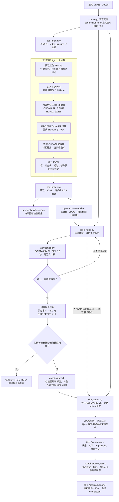

# 从一帧视频到一份工位巡检报告

> 这是当前迁移前代码的数据流。新版目标为C++业务节点与llama.cpp，见 [6个大任务计划](每日开发路线.md)；下文Python bridge/Transformers属于已有参考实现。

先沿着这一条主线理解项目：**读取画面 → RT-DETR检测 → 判断工位是否离席 → 固定事件图片 → Qwen2-VL生成说明 → 核对身份与时效 → 保存报告。**

检测持续运行；离席确认后才发出一次大模型请求。下面以 Day25/30 的 PC C++/TensorRT 路径为主，文件与函数均对应当前源码。

## 1. 先看完整运行流程

图里有两条不同节奏的工作：C++ 不断处理帧，协调器不断观察快照；一次 VLM 请求只分析已经固定的图片。当前请求运行期间，新检测结果仍然可以产生，但两个模型共用 GPU，实际延迟仍需测量。

**协调器订阅的是 `/perception/snapshot`。** 这个消息同时包含图片和该帧检测，因此人员判断、事件图片和报告的源帧能够保持一致。`/perception/detections` 用于观察持续检测结果，不是当前巡检状态机的直接输入。

## 2. 同一帧的数据具体怎样变化

下面只跟随一张被选为快照的帧。其余帧也做检测，但不一定生成图片快照。

```mermaid
flowchart LR
    RGB["原图 RGB uint8<br/>H × W × 3"] --> HOST["lane 独立 pinned host buffer"]
    HOST -->|"H2D"| DEVICE["GPU RGB buffer"]
    DEVICE --> PREP["CUDA预处理<br/>float RGB /255"]
    PREP --> TENSOR["images<br/>1 × 3 × 640 × 640"]
    TENSOR --> DETR["RT-DETR / TensorRT"]
    DETR --> RAW["rtdetr_detections<br/>1 × 300 × 6"]
    RAW -->|"D2H + CPU解码"| BOXES["原图坐标框<br/>class_id、score、xyxy"]

    RGB -->|"提交时低频采样，独立复制"| PIC["缩略图 PPM<br/>base64字符串"]
    BOXES --> JOIN["同一个 Result / JSONL<br/>session + frame + stamp"]
    PIC --> JOIN
    JOIN --> BR["bridge映射类别名<br/>PPM解码并编码成JPEG"]
    BR --> SNAP["Snapshot<br/>JPEG + detections + 源帧身份"]
    SNAP -->|"detections、尺寸与时间戳"| STATE["工位离席状态机"]
    SNAP -->|"离席事件固定后：JPEG + question"| QWEN["Qwen processor<br/>视觉输入 + 文本 tokens"]
    QWEN --> TEXT["生成回答文本"]
```

`[1,300,6]` 的每一行是 `[x1,y1,x2,y2,score,class_id]`。四个坐标在导出模型中为归一化数值，C++ 按原图宽高还原；没有额外 NMS。这个输出负责给出检测框。

Qwen读取的是 **JPEG图片与问题文本**，再由自己的视觉编码器生成内部表示。DETR的框用于工位状态判断；它的中间特征和部署输出张量没有传入Qwen。需要人工复核的物品外观、位置和说明由Qwen根据图片生成。

| 数据经过的位置 | 传递的数据 | 保留下来的身份 |
|---|---|---|
| 图像池 → C++调度器 | `Item{lease, meta}`；队列不复制整张原图 | `slot + generation` 防止读取被复用的内存；`session + frame` 标识源帧 |
| C++ → bridge | 每帧一条JSONL，包含框与耗时；低频帧另含 `snapshot_ppm` | `session_id + frame_id + captured_unix_ns` |
| bridge → coordinator | `Snapshot`：JPEG、同帧检测、原图尺寸、时钟信息 | `session_id + frame_number + header.stamp` |
| coordinator → VLM | `AnalyzeScene.Goal`：固定Snapshot、question、生成与时效限制 | 源帧身份，再加 `request_id` |
| VLM → coordinator | `SceneAnswer`：状态、回答、模型、耗时、原因 | 回传同一个 `request_id` 与源帧身份 |
| coordinator → 本地文件 | 事件图片、最新状态JSON、状态变化JSONL | `event_id` 关联图片；记录源帧与请求身份 |

这里发生了CPU内存复制、H2D/D2H、图片编码和ROS消息传递。独立图片保证VLM处理时原图槽位可以继续用于后面的帧。

## 3. 用一个具体事件串起来

假设镜头对着一个工位，系统先看到有人使用，之后人离开：

1. **看到有人。** bridge发布Snapshot，`Coordinator.on_snapshot()` 从该消息的同帧检测里查找ROI内的 `person`。`WorkstationMonitor.update()` 连续观察有人满2秒，进入 `OCCUPIED`。
2. **看到持续无人。** 第一张无人快照开始无人计时；后续源帧连续无人满10秒，状态变成 `REPORTED`，产生一个 `Departure` 事件。程序刚启动就是空桌、短遮挡或没有新帧，都不能直接产生这个事件。
3. **固定图片。** 假设触发帧是 `session=S1, frame=420`，协调器保存该帧JPEG，并设置 `pending_event` 和 `pending_snapshot`。后面来的421、422帧只更新观察，不替换420帧的事件图片。
4. **发起分析。** `Coordinator.tick()` 确认服务可用、事件图片尚未过期，生成 `request_id=R1`，发送图片与工位巡检问题。协调器把它放入 `active`，同时只运行一个请求。
5. **生成回答。** 服务端先验证输入并占用模型槽，`Qwen2VLBackend.generate()` 解码图片、构建提示、运行模型、解码新生成的tokens。检测支路继续处理后续帧。
6. **核对并保存。** `Coordinator.on_result()` 要求结果仍为 `R1 / S1 / 420`，检查超时、图片年龄和场景是否已经变化。有效结果保存为 `OK`；过期、取消或场景变化时清空成功文本并记录状态与原因。

事件输出位于 `runs/workstation/`：`<event_id>.jpg` 是固定图片，同名 `.json` 是事件最新状态，`events.jsonl` 追加保存状态变化。图像文件按触发时保存，终态报告在结果或失败到达时更新。

人返回、快照过期或源会话重启，会使待处理/运行中的旧巡检失效。程序申请取消后，仍然等待服务端实际结束才释放活动请求；模型忙时新离席事件记为 `SKIPPED_BUSY`。每次确认的占用→离席只触发一次，下一次确认有人后重新布防。

手工问题也进入同一个协调器，使用当时最新快照，会替换待处理问题并使活动请求过时。因此只要先理解上面的事件链路，再看 `on_question()` 就能理解手工问答。

## 4. 沿这条顺序读代码

不要从37个每日目录依次寻找独立实现。`days/dayNN/run.py` 是当天实验入口，它们调用同一套共享模块。按下面顺序可以把完整程序接起来。

| 顺序 | 文件与关键函数 | 阅读时只追踪这一件事 |
|---:|---|---|
| 1 | [tools/course.py](tools/course.py)：`run_day()`、`ros_launch()`；[course.launch.py](ros_ws/src/edge_assistant/launch/course.launch.py) | Day25如何读取配置并启动bridge、coordinator、VLM服务 |
| 2 | [cpp_bridge.py](ros_ws/src/edge_assistant/edge_assistant/cpp_bridge.py)：`__init__()` | bridge如何启动实际C++子进程 |
| 3 | [pc/src/main.cpp](pc/src/main.cpp)：`make_item`、采集线程、`submit`、`consume` | 一帧如何进入图像池、队列、GPU lane并输出结果 |
| 4 | [cuda_backend.cu](pc/src/cuda_backend.cu)：`submit()`、`launch()`、`poll()`；[edge.hpp](pc/include/edge.hpp)：`decode_detr_row()` | 原图怎样成为模型输入；完成事件之后怎样取回检测框 |
| 5 | [cpp_bridge.py](ros_ws/src/edge_assistant/edge_assistant/cpp_bridge.py)：`read_lines()`、`publish_latest()` | C++结果怎样成为两种ROS消息，快照怎样保持同帧 |
| 6 | [coordinator.py](ros_ws/src/edge_assistant/edge_assistant/coordinator.py)：`on_snapshot()`；[workstation.py](ros_ws/src/edge_assistant/edge_assistant/workstation.py)：`update()` | 人员检测怎样变成一次离席事件 |
| 7 | [coordinator.py](ros_ws/src/edge_assistant/edge_assistant/coordinator.py)：`tick()`；[vlm_server.py](ros_ws/src/edge_assistant/edge_assistant/vlm_server.py)：`accept()`、`execute()`；[backends.py](ros_ws/src/edge_assistant/edge_assistant/backends.py)：`generate()` | 事件图片怎样进入Qwen，生成结果怎样返回 |
| 8 | [coordinator.py](ros_ws/src/edge_assistant/edge_assistant/coordinator.py)：`on_result()`、`publish_answer()`；[workstation.py](ros_ws/src/edge_assistant/edge_assistant/workstation.py)：`EventStore.write()` | 怎样确认报告对应正确图片并落盘 |

第一次读只跟随 `frame / snapshot / pending_event / active / answer` 这几个变量。理解一次正常离席后，再读图像池的generation、有界丢帧、取消和过期检查，它们负责保证这条主线在过载和异常情况下仍然成立。

## 5. 模型准备与其他输入如何接入

模型转换在正式运行前完成：Day03建立PyTorch参考；Day04导出ONNX并做ORT对齐；Day05生成本机 `detector.plan`；Day06检查TRT精度。核心实现是 [detr_tools.py](tools/detr_tools.py) 和 [rtdetr_backend.py](ros_ws/src/edge_assistant/edge_assistant/rtdetr_backend.py)。这些产物在运行时加载，不在每一帧里重新导出或构建。

Day19通过 [assets.py](tools/assets.py) 把视频离线解码成PPM。C++读取这些帧并按30fps节拍回放，使用回放时重新生成的时间戳；模型耗时不包含离线视频解码。

Python功能入口是另一种感知前端：`workstation.launch.py → demo.launch.py → perception_node.py → RTDetrBackend.predict()`。它直接读取视频或相机，用PyTorch检测，发布相同的Snapshot；**从上图的Snapshot节点开始，后面的状态机、Qwen与报告流程完全相同。** C++/TensorRT路径用于学习和测量端侧推理优化，Python路径方便先调通场景。

Jetson将C++的PPM读取部分替换为相机采集，沿用检测、bridge与巡检流程；相机缓冲区的共享与归还机制见 [架构与验收](架构与验收.md)。目前没有板卡，可以先沿本文的PC路径学习。

实际启动命令与素材准备见 [工位巡检场景](工位巡检场景.md)，模型张量协议见 [RT-DETR部署说明](RT-DETR部署说明.md)。本文描述当前源码流程；实际运行验证范围见 [验证说明](验证说明.md)。
