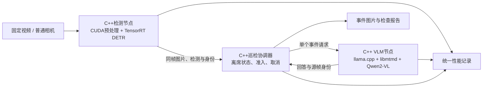

# 端侧模型推理优化：6个大任务实施计划

更新：2026-10-14。目标平台为现有 NVIDIA GPU 电脑（WSL/Linux）与 Jetson Orin Nano 8GB / Super。项目目录沿用 `edge-ai-37day`，计划已改为按大任务推进。

2026-10-19 实施对齐：检测模型固定为当前已部署的 **Ultralytics RT-DETR-L**，
代码、引擎配置与验收记录入口为 [../cpp/README.md](../cpp/README.md)。
默认 1 lane，双 lane 保留作对照；历史 INT8 性能记录与新 FP16 基线分别归档。
旧 `pc/`、Python ROS 和 RT-DETRv2-S 工具保留为迁移参考。

**核心目标：用 C++、TensorRT 与 llama.cpp 建立可测量的端侧视觉检测和 VLM 推理系统，在共享 GPU 与有限内存下，优化延迟、内存和任务调度。** 工位离席巡检用于提供真实负载与质量验收。

## 先看时间与交付

按每天约4–6小时有效投入估算，总计约 **15–22个有效工作日**。每天只有2–3小时时按工作量延长。环境安装、首次模型兼容、C++迁移与板卡适配存在波动；以任务验收通过作为下一阶段起点。

| 大任务 | 预算 | 完成时拿得出的东西 |
|---|---:|---|
| 1. 固定场景、模型与测量基线 | 2–3天 | 固定输入集、模型版本与精度参考 |
| 2. 完成并优化 DETR 的 C++/TensorRT 推理 | 3–4天 | 可独立运行的检测程序、性能对比与一次针对瓶颈的优化实验 |
| 3. 用 llama.cpp 完成 VLM 的 C++/CUDA 推理 | 3–4天 | 可独立分析图片的 C++ VLM 后端、量化与阶段耗时记录 |
| 4. 组成统一的 C++ 事件驱动系统 | 3–4天 | 检测、离席判断、VLM与报告完整运行；统一启动入口 |
| 5. 测量并优化双模型资源竞争 | 2–3天 | 单模型/共运行对比、调度策略、质量与性能报告 |
| 6. 迁移 Orin Nano 并完成板端验收 | 2–4天 | 板端重建产物、内存/温度/延迟记录、持续运行演示 |

任务1–5约13–18天，可在现有GPU电脑上完成；暂时没有Jetson时先交付PC版，任务6等有板卡后继续。任务2或3超出预算时优先解决单模型正确性，暂缓选做优化与板端阶段。

## 项目边界与目标架构

| 能力 | RK3588多光谱种子检测 | 本项目：Jetson端侧推理优化 |
|---|---|---|
| 核心问题 | 从传感器到NPU的视觉数据通路 | 模型怎样在GPU上正确、高效且可控地运行 |
| 重点 | Sensor、RAW/ISP、RGA、DMA-BUF、RKNN | CUDA、TensorRT、llama.cpp、C++运行时、资源调度 |
| 输入工作量 | 深入相机与格式、内存共享 | 使用固定视频/图片，必要时接现成相机 |
| 主要证据 | 数据通路正确性、CPU占用、拷贝次数、采集到结果延迟 | 模型精度、阶段耗时、尾延迟、VLM响应、内存和共运行影响 |

下图是本轮计划的**目标架构**。现有仓库已有DETR/CUDA核心和Python场景原型；C++ ROS节点、llama.cpp后端与统一双模型评测仍需按任务实现。

业务运行时使用C++；模型导出、数据集评估和日志分析保留Python。每个节点边界尽量清楚，不为“全C++”重写离线工具。DETR与VLM共用GPU，分别维护任务和缓冲；VLM输入是事件图片与问题。

必做：DETR FP16部署、预处理数值对齐、CUDA完成与buffer生命周期、llama.cpp CUDA VLM、统一C++事件链路、双模型性能和质量评测。

选做：DMA-BUF/EGL、检测INT8、CUDA Graph、硬件视频解码、全GPU渲染。只有测量发现相关瓶颈且主线已通过，才选择其中一项。相机驱动、ISP开发、机械控制、SLAM不进入本项目主线。

## 任务1：固定场景、模型与测量基线（2–3天）

**完成目标：** 后续所有优化有相同的输入、正确性参考和版本记录。

工作顺序：

1. 固定开发环境，记录GPU、驱动、CUDA、TensorRT、编译器；模型工具与运行程序分开管理依赖。CPU测试先用于检查基本工具链。
2. 选定 Ultralytics RT-DETR-L 与 Qwen2-VL-2B，不在主线反复更换模型。保存权重来源、revision/文件哈希；llama.cpp的具体commit在任务3确认后锁定。
3. 准备工位图片与视频，覆盖空桌、正常占用、短遮挡、离席、返回。为物品描述准备人工核对清单，为人员占用/离席标注时间段；另外用断流与忙状态做故障输入。
4. 用PyTorch建立DETR参考。保留一个显式COCO格式标注子集用于部署精度比较，避免只比较一张图片；工位视频另评估事件误触发与漏触发。
5. 写实验配置：输入尺寸、阈值、回放节拍、预热数量、测量窗口和精度容许差。区分“离线解码后的推理耗时”与“视频输入到报告的总耗时”。

**可复用：** [RT-DETR工具](tools/detr_tools.py)、[模型适配器](ros_ws/src/edge_assistant/edge_assistant/rtdetr_backend.py)、[素材工具](tools/assets.py)、现有CPU测试。

**交付：** 环境与模型清单、数据清单、检测参考结果、工位事件标注、统一实验配置。建议保存在 `runs/milestone01/`，输入在 `data/`，模型产物在 `artifacts/`。

**验收：** 参考框与图片对应；测试集有来源和标注；不存在用空检测结果“互相通过”或把模拟结果作为模型精度的情况。没有标注的数据只报告部署对齐，不宣称mAP或场景准确率。

## 任务2：DETR C++/TensorRT部署与GPU优化（3–4天）

**完成目标：** 独立运行检测程序，并通过真实测量选择一套合理的推理配置。

工作顺序：

1. 沿现有PyTorch → ONNX → ORT对齐 → TensorRT链路生成本机引擎。当前 RT-DETR-L 输入 `images [1,3,640,640]`、输出 `output0 [1,300,6]`，按引擎读取实际名称并记录I/O精度。
2. 复用C++串行程序作为可调试基线。确认RGB、双线性拉伸、半像素坐标、除255和坐标还原一致，再测速度。
3. 比较CPU预处理与当前融合CUDA预处理；当前kernel已完成resize、布局转换与归一化，不把现有融合包装成新实现。需要研究融合收益时，再增加分步CUDA版本作为实验基线。
4. 比较1/2 lane；每个lane独立stream、context和buffer，同一帧的预处理与推理先在同一stream内保持顺序。通过完成事件判断是否可以回收，不能按等待时长猜测完成。
5. 用Nsight Systems定位拷贝、空隙、排队与重叠。若某个kernel确为瓶颈，再用Nsight Compute研究访存和执行；选择一次有依据的修改，记录前后结果。

**可复用：** [main.cpp](pc/src/main.cpp)、[cuda_backend.cu](pc/src/cuda_backend.cu)、[edge.hpp](pc/include/edge.hpp)、[DETR部署契约](RT-DETR部署说明.md)。图像池、红色区域CPU/CUDA教学后端保留作测试和回顾，不另排数天重写。

**交付：** 可独立运行的C++检测程序、引擎manifest、精度报告、串行/异步对比、性能时间线与优化实验记录，写入 `runs/milestone02/`。

**验收：** CUDA预处理相对匹配CPU参考最大误差≤0.002；现有逐框门槛为score≥0.35、同类一对一IoU≥0.90、分数差≤0.08。数据集精度变化另按任务1事先确定的预算验收。性能结果包含完成率、丢帧、P50/P95/P99和退出时资源归还；优化失败也保留原因与负结果。

**控制范围：** DETR图内已有TopK，输出仅300×6个数值。暂保留CPU坐标还原，只有测量证明后处理值得优化时才增加GPU实现。FP16为必做；INT8与CUDA Graph不阻塞后续任务。

## 任务3：llama.cpp VLM C++/CUDA推理（3–4天）

**完成目标：** C++后端能够独立接收一张图片和问题，用真实GPU推理返回回答，并提供清楚的耗时记录。

工作顺序：

1. 选择支持Qwen2-VL-2B与CUDA多模态推理的llama.cpp版本，固定commit、构建配置及依赖。先用该版本自带的多模态工具验证权重、图像和GPU后端。
2. 准备兼容的语言模型GGUF与配套视觉模型文件。以Q4_K_M作为首个候选；有可用权重且内存允许时再比较Q8或其他高精度参考。文件量化类型分别记录，不假定视觉部分也被量化成4bit。
3. 基于所固定版本的llama.cpp/libmtmd接口实现一个C++图片分析入口，输入图片、问题与输出长度，输出回答与请求标识；先单独运行，再接ROS。
4. 增加请求和推理阶段时间点。区分图片准备、视觉编码、prefill、首token、decode和整体完成；第三方接口不能可靠拆出的阶段明确记为未分离，不能把全部等待时间都叫prefill。
5. 逐项比较图片尺寸、上下文上限和输出长度，记录内存与回答质量。保留少量固定图片/问题做回归，不仅看能否生成中文。

**可复用：** 现有 [backends.py](ros_ws/src/edge_assistant/edge_assistant/backends.py) 作为Python行为参考；[core.py](ros_ws/src/edge_assistant/edge_assistant/core.py) 中输入、身份、时效和单请求规则作为迁移依据。两者均不等于已完成llama.cpp实现。

**需要新增：** C++ llama.cpp适配层、独立图片分析入口、模型配置与阶段计时。目标代码可归入 `runtime/vlm/`，这是拟建目录。

**交付：** 固定版本的真实VLM后端、模型清单、图片问答回归结果、参数/量化对比，写入 `runs/milestone03/`。

**验收：** 日志确认实际启用GPU后端与卸载配置；回答确实来自输入图片；能测得端到端首token时间和整体响应时间；取消/限时请求不会把部分输出当成功报告。若某个量化方案无法加载或超内存，记录为不可用，不强行比较其速度。

## 任务4：统一C++事件驱动系统（3–4天）

**完成目标：** 一个入口启动C++感知、巡检协调和VLM三个节点，能从视频完成一次离席检查。

工作顺序：

1. 用 `rclcpp` / `rclcpp_action` 实现业务节点。复用当前ROS消息与Action定义，检测节点直接发布消息；将已有C++推理核心整理为可调用模块，去掉主运行路径的stdout JSONL→Python bridge。
2. 把工位状态机与协调器迁移为C++。保持先确认占用、再确认离席、固定触发快照的行为，保留人员返回、断流、乱序和会话重启规则。
3. VLM服务节点调用任务3的C++后端。保持一个活动请求、有界待处理数据；接受取消不等于GPU已经停止，必须等实际结束后释放模型槽。
4. 保存事件图片、request/event/frame身份与终态。保留手工提问作为复核入口；默认场景按事件调用，不做持续聊天。
5. 将Python感知路径和mock明确放入基线/测试用途。保留一个面向用户的正式启动入口，配置文件统一管理模型路径、输入、阈值和预算。

**可复用：** [现有消息定义](ros_ws/src/edge_interfaces)、[workstation.py](ros_ws/src/edge_assistant/edge_assistant/workstation.py)、[coordinator.py](ros_ws/src/edge_assistant/edge_assistant/coordinator.py) 及其测试用例。保留原规则语义，在新实现上复跑同等边界情况。

**需要新增：** C++ ROS包、直接发布结果的接口、C++事件协调与持久化；现有Python文件提供参考，完成迁移前不删除。

**交付：** 正式C++运行入口、参数配置、完整事件样例及集成测试，写入 `runs/milestone04/`。

**验收：** 初始空桌和短遮挡不触发；正常离席只触发一次；人返回、断流和输入过期使旧事件失效；忙状态有明确记录；回答绑定触发帧。运行时业务节点不依赖Python Transformers。跨进程ROS图片传递仍按实际复制记录，不宣称全链路零拷贝。

## 任务5：双模型资源竞争与场景验收（2–3天）

**完成目标：** 用同一输入与负载，解释DETR和VLM一起运行时的瓶颈，给出可复现的配置选择。

依次运行四组实验，每组重复测量并保存原始日志：

| 实验组 | 固定内容 | 用途 |
|---|---|---|
| A：只开DETR | 同一视频、阈值、输入节拍 | 检测延迟与内存基线 |
| B：只开VLM | 同一组事件图片、问题与生成配置 | 视觉理解质量、TTFT和完成时间基线 |
| C：两者共运行 | A/B相同输入与配置、可复现触发时刻 | 测量检测P99、VLM响应与内存的互相影响 |
| D：调整一个调度/资源参数 | 沿用C，每次只改一个因素 | 判断限频、图像预算、lane数或输出长度是否改善整体结果 |

先保留当前single-flight、固定快照与忙拒绝。根据测量再加入最小触发间隔、重复事件合并或其他有界准入策略；报告接受、跳过、取消、超时和成功次数，不能只报告成功请求的平均延迟。

场景样本应覆盖空桌、短遮挡、离席、返回、断流、忙状态六类。对正常事件统计误触发/漏触发与检测延迟；对报告人工核对物品、位置和无根据推断。性能调优后要复查这些质量结果。

**可复用：** [analyze.py](tools/analyze.py) 的检测日志统计；它目前不包含完整VLM和共运行指标，需要扩展统一记录与分析。现有长时间检测脚本也不能直接作为双模型稳定性证据。

**交付：** 四组原始日志与汇总表、至少一份时间线、资源配置决策、报告质量检查与PC演示，写入 `runs/milestone05/`。这是没有Jetson时的完整PC交付点。

**验收：** 证明结论来自同条件对比；同时报告质量、检测尾延迟、VLM响应和内存。改善无效或有取舍时如实解释，不预填“8ms降到1.5ms”“20FPS升到80FPS”等成绩。

## 任务6：Orin Nano迁移与板端验收（2–4天）

**完成目标：** 将已经通过PC验证的系统部署到Orin Nano 8GB / Super，给出独立板端结果。

工作顺序：

1. 记录JetPack/L4T、CUDA、TensorRT、编译器、llama.cpp commit、电源模式和散热条件。使用已验证的兼容组合，不复制PC的环境假设。
2. 板上重新构建TensorRT plan和C++程序；llama.cpp针对板端CUDA环境构建。先分别验证DETR和VLM，再合并运行。
3. 优先用与PC相同的固定视频/图片回放比较；需要现场演示时接现成可用相机，输入适配不扩展成驱动或DMA-BUF开发任务。
4. 测量系统整体与进程内存，包含模型、视觉部分、KV缓存、TRT工作区、每lane缓冲、ROS和系统余量。8GB是共享内存，不能简单把两个模型文件大小相加。
5. 用任务5的实验组复测，再做至少30分钟的检测+受控VLM请求共运行。记录实际温度、功耗模式、请求终态、内存稳定性、检测P99和异常退出。

**可复用：** 平台无关C++推理和协议代码、环境探针、已有板端构建经验。`jetson/` 中DMA-BUF/EGL和相机能力探针作为扩展参考，不作为本任务前置条件。

**交付：** 板端环境与配置、板端精度/场景回归、共运行与稳定性报告、演示视频，写入 `runs/milestone06/`。

**验收：** 有实际板端执行证据；模型与事件身份正确；无持续内存增长；性能结论附功耗模式、温度和测试条件。若模型不能同时驻留，应记录失败边界并调整模型/资源预算；使用外部VLM时必须改标分布式方案，不能宣称全板端完成。

## 全部实验使用同一套指标

| 指标 | 定义与边界 |
|---|---|
| 检测阶段耗时 | 拷贝、预处理、TRT、后处理分别记录；CUDA Event测量对应stream区间 |
| 检测端到端P50/P95/P99 | 从约定的输入获得时刻到结果可消费；说明是否包含解码、排队和ROS传递 |
| 吞吐与丢帧 | 实际测量墙钟窗口内完成帧数；同时报告输入、丢帧与队列上限 |
| TTFT | 从请求进入协调器到首个输出token；另记排队时间与后端首token时间，不能混成一个不可解释的数字 |
| 视觉编码 / prefill | 通过可靠阶段边界测量；无法分开时保留组合耗时并注明 |
| TPOT | 输出token数N>1时，首token到末token的间隔除以N−1；保留原始token时间点 |
| 报告完成时间 | 事件触发到有效终态报告；失败、超时和取消另外计数 |
| 内存与设备状态 | 稳态/峰值内存、GPU利用情况；Jetson补充系统余量、温度和电源模式 |
| 质量 | DETR部署精度、场景事件误触发/漏触发、VLM事实与位置描述核对 |

CUDA异步执行的提交时间不能代替完成时间；CPU wall-clock与GPU Event分开记录。调试校验和正式性能测试分开运行，避免同步或图片落盘改变被测结果。PC与Jetson分别报告，不共用FPS或内存结论。

## 现有文件怎么用，哪些仍待实现

| 现有部分 | 新计划中的用途与状态 |
|---|---|
| `pc/`、`tools/detr_tools.py` | 已有DETR/CUDA/TRT实现，可复用；GPU目标环境仍需编译和数值验收 |
| Python ROS节点与工位状态机 | 已有功能参考和规则测试；任务4迁移为C++ |
| `backends.py` | 当前为Transformers VLM参考；llama.cpp接入属于任务3待实现项 |
| `tools/analyze.py` | 已有检测统计；任务3/5扩展VLM与共运行指标 |
| `days/dayNN`、`curriculum.json`、`tools/course.py` | 旧版37单元实验与命令索引；编号不是新任务编号 |
| [每日学习与代码手册](每日学习与代码手册.md) | 旧版源码阅读参考；按需要查函数，不再逐天执行 |
| `jetson/`、旧ROS教程 | 平台适配与历史参考；DMA-BUF不进入新版必做验收 |
| [代码流程与数据流](代码流程与数据流.md) | 描述当前迁移前实现；本计划上图描述目标架构 |

旧入口继续保留以便复现实验，但 `python days/day25/run.py` 等仍执行旧实现，不能当作新版任务已完成。新产物使用 `runs/milestoneNN/` 避免与旧版 `runs/dayNN/` 混淆；这些目录在执行任务时创建。

## 最终交付与学习顺序

只保留一个主场景、一套C++业务运行时和一份统一benchmark。最终交付包括：可复现构建与启动方法、固定模型/数据配置、单模型及双模型对比、质量回归、一个有测量依据的优化案例、PC或板端演示与已知限制。

阅读顺序为：本计划 → 当前 [代码流程与数据流](代码流程与数据流.md) → 当前任务涉及的源码。环境细节查 [环境搭建](环境搭建.md)，模型契约查 [RT-DETR部署说明](RT-DETR部署说明.md)，场景规则查 [工位巡检场景](工位巡检场景.md)。这些参考文件中的旧Day编号不构成新的学习时间线。

版本与接口以选定版本的官方资料为准：[llama.cpp构建](https://github.com/ggml-org/llama.cpp/blob/master/docs/build.md)、[多模态支持](https://github.com/ggml-org/llama.cpp/blob/master/docs/multimodal.md)、[TensorRT](https://docs.nvidia.com/deeplearning/tensorrt/)、[ROS 2 C++ Action](https://index.ros.org/p/rclcpp_action/)。

本次交付是计划重写，未将待实现的C++ ROS/llama.cpp能力写成现有成果。原代码的实际验证范围见 [验证说明](验证说明.md)。
